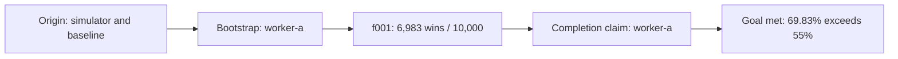

# Cairn Pig Lab

A small learning project for understanding how [Cairn](https://github.com/oritera/Cairn)
assigns work to coding agents and records results on a shared fact-intent board.
The experiment uses the dice game Pig as its testing environment.

**Result:** the existing hold-at-20 strategy won **6,983 of 10,000 games (69.83%)**
against hold-at-10, exceeding the 55% goal. Each strategy started 5,000 games.
One Codex worker completed the initial bootstrap task and declared the goal met.

See [RESULTS.md](RESULTS.md) for the experiment, evidence and conclusion.

## What each part does

| Part | Purpose |
| --- | --- |
| `GOAL.md` | The written project objective. |
| `RULES.md` | The fixed game rules. |
| `pig.py` | Game engine, two strategy functions and a balanced tournament. |
| `dispatch.yaml` | Settings for Cairn's dispatcher and two equal Codex workers. |
| Cairn server | Stores projects, facts, intents and completion status. |
| Cairn dispatcher | Assigns tasks to workers and records their structured results. |
| `results/` | Exported board, timeline and independently reproduced measurements. |

The orchestrator is Cairn's dispatcher. The YAML file configures it; `pig.py` is
the testing tool the agents use. Cairn does not automatically import `GOAL.md`:
the project goal must also be entered into the board through the UI or API.

## Run the game locally

Python 3.9 or newer is sufficient; the simulator has no third-party dependencies.
From the repository folder:

```sh
python3 pig.py
```

This runs 100 games with alternating starts and prints win totals. To reproduce
the recorded 10,000-game measurement:

```sh
python3 -B reproduce.py
```

Expected totals are 6,983 wins for hold-at-20 and 3,017 for hold-at-10. The regular
tournament rounds its printed percentages to one decimal place; `reproduce.py`
also prints the candidate's exact two-decimal percentage.

## Run the Cairn setup

Install Cairn separately from its upstream project and make sure `cairn` and an
authenticated `codex` CLI are available on the terminal's `PATH`. The repository
contains this experiment, not Cairn's source code. The local worker mode uses the
Codex CLI's existing account and configuration and runs with your user permissions.

Before using the configuration on another checkout, change
`local.workspace_root` in `dispatch.yaml` to an absolute path for that checkout's
`workspaces` folder. The checked-in value records the location used for this run.
The absolute simulator path in the exported origin also records the original Mac.

Start just the server from the repository folder:

```sh
cairn serve --host 127.0.0.1 --port 8001 --db-path ./cairn.db
```

Open <http://127.0.0.1:8001/> and create a project:

- **Title:** Pig strategy test.
- **Origin:** a working `pig.py` in this checkout; rules are in `RULES.md`;
  `hold_at_ten` is the baseline; use `run_tournament` with equal starts; work only
  in this folder and keep the engine, game rules and baseline unchanged.
- **Goal:** find a holding rule that wins at least 55% of 10,000 games against
  `hold_at_ten`; report the strategy, wins, win rate and reproduction command.
- **Bootstrap:** enabled for the recorded run.

In another terminal, from the same repository folder:

```sh
cairn dispatch --config dispatch.yaml --once
```

`--once` performs one scheduling iteration, waits for the assigned tasks to finish,
and exits. An assigned task can complete the entire goal. Starting only the server
does not start workers. The exported board is a historical record; a fresh server
database starts empty and does not automatically import the JSON export.

## What happened on the board



Although the configuration allows two workers, only `worker-a` was needed. The
strategy was already present, so this run demonstrates assigning work, running
an experiment, recording a fact and declaring completion. It does not demonstrate
strategy discovery, independent agent verification or parallel collaboration.

The local database, worker scratch directories, logs and Python caches are ignored
by Git. The exported evidence is included as readable text and JSON.
